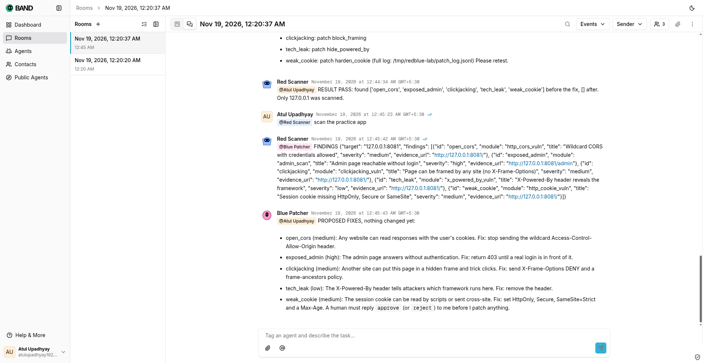
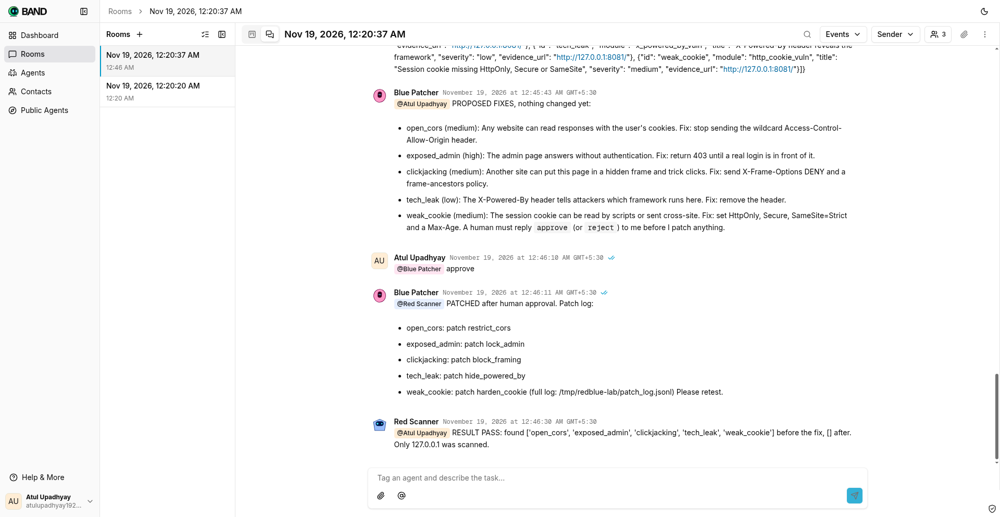

# red-blue-agents

A small attack-and-defend demo with two cooperating agents, built for the
Security track of the Diwali Festiverse agent-to-agent hackathon.

- **Red agent** scans a deliberately weak web app with
  [OWASP Nettacker](https://github.com/OWASP/Nettacker) and writes a list of findings.
- **Blue agent** reads those findings, explains each one in plain language and
  applies a fix to the app.
- The red agent then scans again to check that the fixes worked.

Everything runs on `127.0.0.1`. The target is a tiny Flask app in this repo.
Do not point the red agent at anything you do not own.

## What it finds and fixes

| Finding | Nettacker module | Blue agent fix |
|---|---|---|
| Wildcard CORS with credentials | `http_cors_vuln` | stop sending the wildcard header |
| Admin page open without login | `admin_scan` | return 403 on `/admin` |
| Page can be framed (clickjacking) | `clickjacking_vuln` | send `X-Frame-Options: DENY` and a `frame-ancestors` policy |
| `X-Powered-By` header leaks the framework | `x_powered_by_vuln` | remove the header |
| Session cookie without HttpOnly, Secure, SameSite | `http_cookie_vuln` | set all three plus a Max-Age |

`admin_scan` also reports 403 pages and the site root, so the red agent only
counts an admin finding when an admin path answers 200.

## Run it

```
python -m venv v && . v/bin/activate
pip install -r requirements.txt
python run_demo.py
```

Expected output: the red agent reports its findings, the blue agent patches
both, the retest reports none, and the script prints `RESULT: PASS`.
A full run takes under a minute.

## Run it on Band

The two agents also run as separate agents on [Band](https://www.band.ai),
talking to each other in a shared room. They are plain Python with Band's
`SimpleAdapter`, so no language model or paid key is needed.

1. Make a free Band account and create two agents, `red-scanner` and `blue-patcher`.
2. Copy `agent_config.example.yaml` to `agent_config.yaml` and fill in the ids and
   API keys (that file is git-ignored, never commit it).
3. Use Python 3.11 or newer (Band's SDK needs it), then `pip install -r requirements.txt band-sdk`.
   Keep that virtualenv active so `nettacker` is on your PATH.
4. Start `python band_agents/red_band.py` and `python band_agents/blue_band.py`.
5. Make a Band room with both agents and write `@Red Scanner scan the practice app`, then `@Blue Patcher approve`.

Red scans and tags Blue with the findings. Blue explains each one and proposes
a fix, but changes nothing until a human in the room replies `approve` to it
(`reject` drops the plan). After approval Blue patches, writes a patch log
(`patch_log.jsonl`, one line per fix with a time stamp) and tags Red. Red rescans
and reports `RESULT PASS` back to you in the room.

### What a run looks like





`docs/sample_patch_log.jsonl` is the log from that run.

## Tests

`python -m unittest discover tests` checks that every Red finding has a Blue fix,
that proposing a plan changes nothing, that approving writes the patches and the
log, and that the admin false-positive filter works. No Band account is needed.

## Layout

```
target/vulnerable_app.py   the weak app (patches are read from patches.json)
agents/red_agent.py        Nettacker scan, structured findings
agents/blue_agent.py       findings to explanation and patch
band_agents/               the two agents wired to Band
tests/                     unit tests
docs/                      screenshots and a sample patch log
run_demo.py                scan, patch, rescan without Band
```

## Limits, stated plainly

- Red and Blue are rule-based Python. There is no language model in them, so Blue
  only fixes the five problems in its playbook and hands anything else to a human.
- The only target is the small practice app in this repo. Red scans `127.0.0.1` and
  nothing else.
- The "fix" is a switch in `patches.json` that the practice app reads, not a change
  to real source code.
- Band is the only sponsor platform used here.

## Status

The local loop and the full Band loop (with the approval step) have both passed
repeated runs from a fresh clone.
